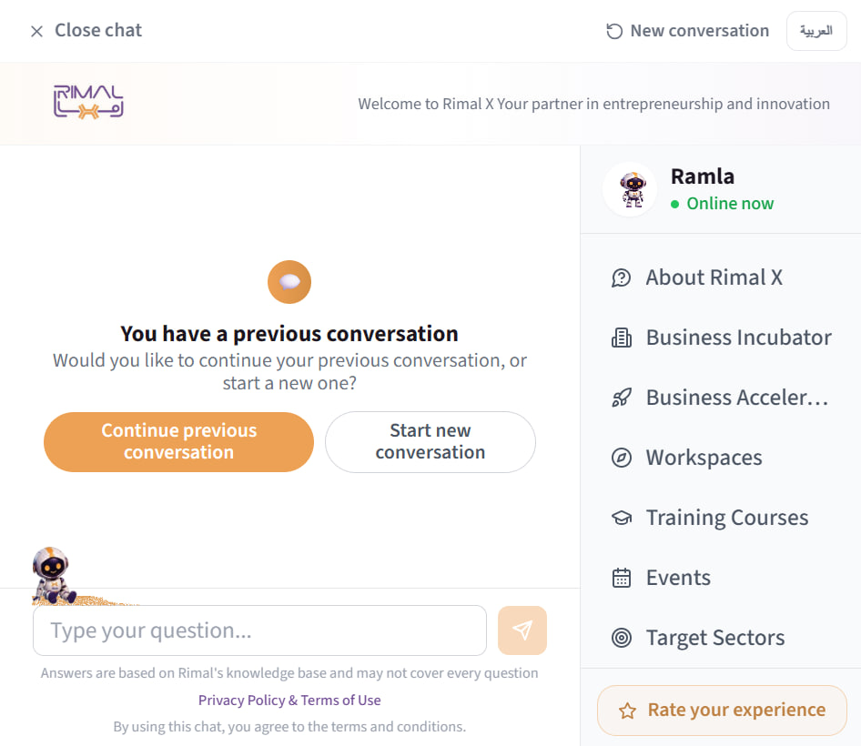

# 🤖 Ramlah — AI Agent Chatbot
### Rimal X AI Assistant Platform

**A production-grade, full-stack RAG chatbot built to automate customer support and lead generation.**

---

> ⚠️ **Live Demo Note:** The live application is currently running in **fallback mode**. The Groq API subscription used during the Co-op training has expired. Therefore, the chatbot currently retrieves answers directly from the **Knowledge Base** (Database) without LLM phrasing, and the lead qualification flow is disabled. The original AI-powered experience and architecture are fully documented below.

---

## 📖 Overview
**Ramlah** is an intelligent AI assistant developed for **Rimal X** during our Co-op training. It solves the problem of repetitive customer support by providing instant, grounded answers in both Arabic and English. Beyond answering questions, Ramlah acts as a lead-generation tool, qualifying visitors based on their budget and team size, and recommending the best service packages.

---

## 👥 The Team
This project was developed collaboratively during the Co-op training at Rimal X.

*   **Lamar Bader Altalhi** — Full-Stack Development
*   **Abeer Alghamdi** — Team Lead & Security/Backend Focus
*   **Bushra Khaled AlGhashmari** — Full-Stack Development

---

## 💻 My Role (Lamar Bader Altalhi)
As a Full-Stack Developer on the team, I contributed to building the web experience and the chatbot itself:

- **Web Development:** Helped build the chatbot's web interface and the chat widget users interact with.
- **Chatbot Development:** Contributed to the chatbot logic that answers customer inquiries from the knowledge base.
- **Requirements & Testing:** Analyzed requirements, tested chatbot functionality, and evaluated response accuracy to support performance improvements.

---

## 🚀 Key Features

| Feature | Description |
|:---|:---|
| **Grounded RAG System** | 11 Categories and 150+ Q&A records. The LLM generates answers *only* from the approved knowledge base to eliminate hallucinations. |
| **Smart Lead Qualification** | Asks structured questions (budget, team size, usage type) and saves structured leads to the database, recommending tailored services. |
| **Advanced Security** | All database writes are protected via Edge Functions. API keys are never exposed to the client. |
| **Admin Knowledge Base** | Human review gates website-extracted content before it becomes answerable knowledge. |
| **Conversation Memory** | Retains context for 3 days via localStorage and sends an 8,000-character history to the LLM for natural follow-ups. |
| **Safe Handling** | Out-of-scope questions receive a warm decline, and small talk is handled without factual grounding to ensure accuracy. |

---

## 🛡️ Security In Action (Proof of Authorization)

The system enforces strict Row-Level Security (RLS). Even if a user successfully authenticates (logs in), the system verifies their specific role in the database before granting access to the Admin Dashboard.

 
<i>Authentication vs. Authorization: A logged-in user without an assigned admin role is rejected.</i>

---

## 📸 System Screenshots

### 💬 Live Chat Widget Interface

  

### ⚙️ Admin Dashboard

---

## 🛡️ Security Highlights
- **Zero Client-Side Trust:** The browser uses a public anon key, but direct inserts on protected tables (Leads, Conversations, Messages) are rejected.
- **Edge Function Architecture:** All writes go through a single `chat-write` Edge Function that validates inputs and applies rate limiting.
- **Role-Based Access Control:** Strict RLS policies ensure that a `conversations_viewer` cannot access leads or settings, while `super_admin` has full operational access.

---

<i>Note: The source code for this project is proprietary to Rimal X and hosted in a private repository. This repository is a technical showcase of the project and my contributions. Team showcase: <a href="https://github.com/Eng-Abeer18/Ramlah-AI-Chatbot">Eng-Abeer18/Ramlah-AI-Chatbot</a></i>

