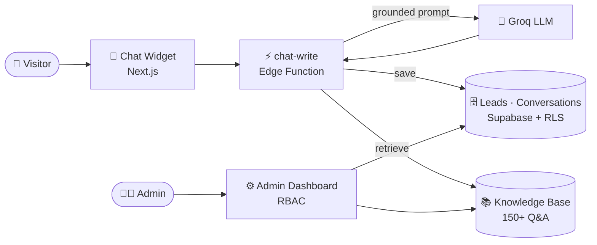
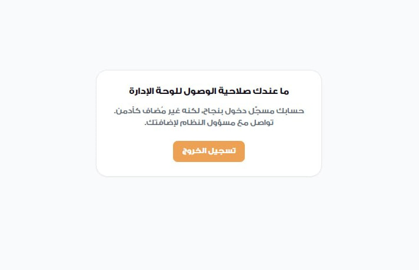
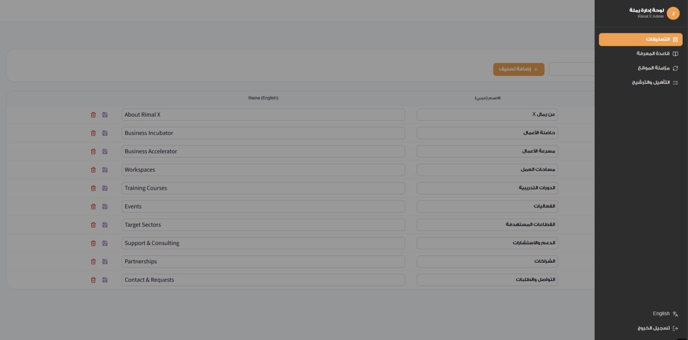

### 🤖 A full-stack, bilingual AI assistant that answers customers instantly and turns visitors into qualified leads

---

## 👩‍💻 My Role — Lamar Bader Altalhi
**Full-Stack Developer** · Co-op Training at **Rimal X** · 06/2026 – 08/2026

<table>
<tr>
<td width="50%" valign="top">

### 🎨 Web & Chat Experience
- Built parts of the **chat widget interface** that customers use to talk to Ramlah.
- Worked on a **bilingual (Arabic / English)** experience so answers read naturally in both languages.
- Helped shape the flow from first message to **lead qualification**, keeping the conversation simple for the visitor.

</td>
<td width="50%" valign="top">

### 🧠 Chatbot Development
- Contributed to the **chatbot logic** that answers questions only from the approved knowledge base.
- Helped prepare and organize **knowledge-base content** across the service categories.
- Worked on handling **out-of-scope questions** and small talk gracefully.

</td>
</tr>
<tr>
<td width="50%" valign="top">

### 🧪 Testing & Quality
- **Tested the chatbot end-to-end** across real customer questions.
- **Evaluated response accuracy** and reported gaps to improve answers.
- Verified behavior in both languages and across devices.

</td>
<td width="50%" valign="top">

### 📋 Requirements & Teamwork
- **Analyzed requirements** with the team to define what Ramlah should answer and collect.
- Collaborated in a 3-person team under a shared development cycle.
- Documented features and results for the final delivery.

</td>
</tr>
</table>

---

## 📖 Overview
**Ramlah** is an intelligent AI assistant built for **Rimal X** during our Co-op training. It removes repetitive customer support work by giving **instant, grounded answers in Arabic and English**. Beyond answering questions, Ramlah acts as a **lead-generation tool**: it qualifies visitors by budget and team size, then recommends the most suitable service package.

> [!NOTE]
> The live demo currently runs in **fallback mode**: the Groq API subscription used during the training has expired, so the chatbot answers directly from the **knowledge base** without LLM phrasing, and lead qualification is disabled. The original AI-powered experience is documented below.

---

## 🚀 Key Features

| | Feature | What it does |
|:--:|:---|:---|
| 📚 | **Grounded RAG** | 11 categories and **150+ Q&A records**. Answers come *only* from the approved knowledge base, so no made-up information. |
| 🎯 | **Smart Lead Qualification** | Asks about budget, team size and usage type, saves structured leads, and recommends tailored services. |
| 🌍 | **Bilingual** | Understands and replies in Arabic and English. |
| 🧠 | **Conversation Memory** | Keeps context for 3 days and sends an 8,000-character history for natural follow-ups. |
| 🗂️ | **Admin Knowledge Base** | Human review approves website-extracted content before it becomes answerable. |
| 🛡️ | **Security First** | All writes go through Edge Functions; API keys never reach the browser. |

---

## 🏗️ How It Works

---

## 📸 Screenshots

| 💬 Chat Widget | 🛡️ Role Check |
|:--:|:--:|
|  |  |
| *Instant bilingual answers* | *Logged-in users without an admin role are rejected* |

### ⚙️ Admin Dashboard

---

<b>🛡️ Security highlights</b>

 

- **Zero client-side trust:** the browser uses a public anon key, and direct inserts on protected tables (Leads, Conversations, Messages) are rejected.
- **Edge Function architecture:** every write goes through one `chat-write` function that validates input and applies rate limiting.
- **Role-based access:** Row-Level Security makes sure a `conversations_viewer` cannot see leads or settings, while `super_admin` has full access.

---

## 👥 The Team

| Name | Role |
|:---|:---|
| **Lamar Bader Altalhi** | Full-Stack Development · Web & Chatbot |
| **Abeer Alghamdi** | Team Lead · Security & Backend |
| **Bushra Khaled AlGhashmari** | Full-Stack Development |

---

🔒 The source code is proprietary to <b>Rimal X</b> and kept in a private repository. This repository showcases the project and my contributions. Team showcase: <a href="https://github.com/Eng-Abeer18/Ramlah-AI-Chatbot">Eng-Abeer18/Ramlah-AI-Chatbot</a>

