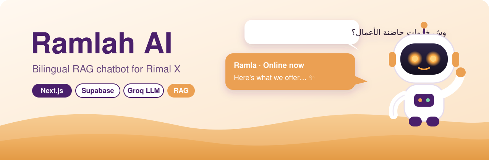

<h1 align="center">Ramlah AI 🤖</h1>

  Bilingual AI chatbot that answers customer questions for <b>Rimal X</b> from an approved knowledge base.

  <a href="https://ramlax-chat.vercel.app/"><b>Live Demo</b></a> ·
  Next.js · Supabase · Groq LLM · RAG

  
  &nbsp;
  

## My Role
**Lamar Bader Altalhi · Full-Stack Developer** · Rimal X Co-op, 2026

- Helped build the web interface and chat widget.
- Contributed to the chatbot development.
- Analyzed requirements, tested the chatbot and evaluated answer accuracy.

## Features
- **Grounded answers** from 150+ approved Q&A, in Arabic and English.
- **Lead qualification** by budget and team size, with service recommendations.
- **Admin dashboard** with role-based access.

## Team
**Lamar Bader Altalhi** · Abeer Alghamdi (Team Lead) · Bushra Khaled AlGhashmari

---

The live demo runs in fallback mode (knowledge base only) since the training's Groq subscription ended. Source code is private to Rimal X. Team showcase: <a href="https://github.com/Eng-Abeer18/Ramlah-AI-Chatbot">Eng-Abeer18/Ramlah-AI-Chatbot</a>
